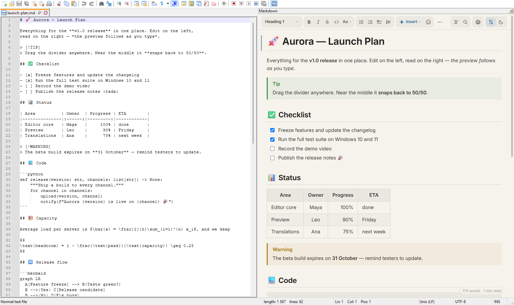
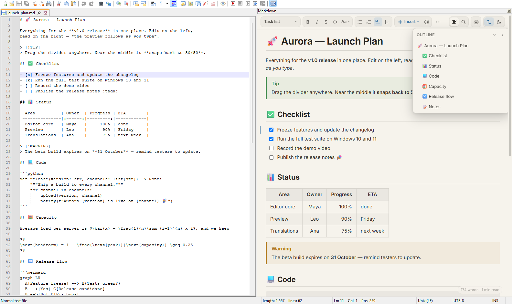
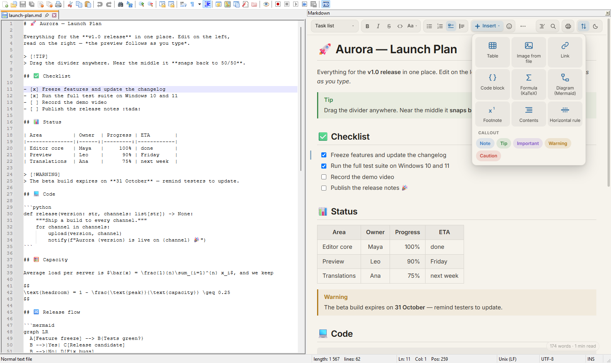
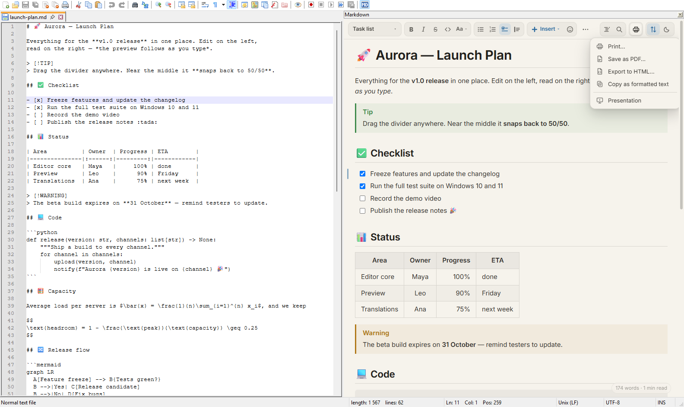
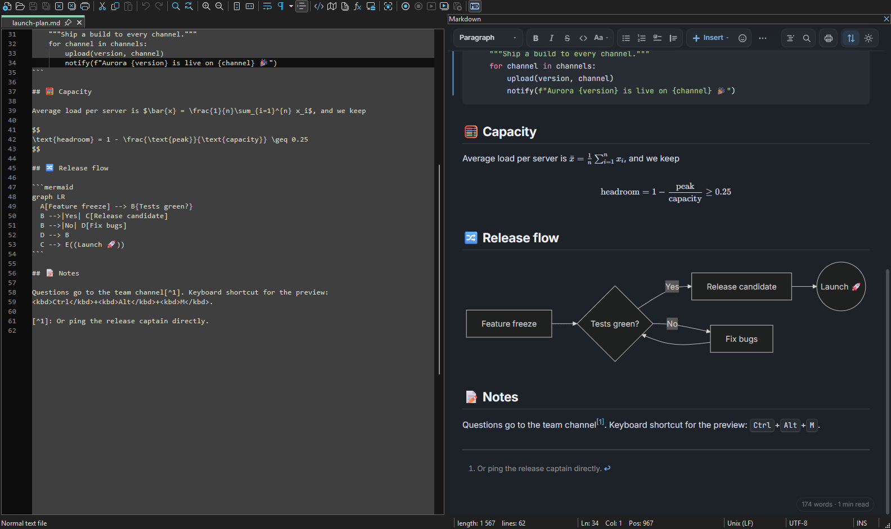

# Markdown Live for Notepad++

**A live Markdown preview docked next to the editor — it keeps a 50/50 split, scrolls in sync and comes with a Word-like formatting toolbar.**



Most Markdown preview plugins for Notepad++ dock a panel with a fixed width: resize the window and either the editor or the preview ends up huge. Markdown Live keeps the proportion you choose, renders modern Markdown (tables, task lists, math, Mermaid diagrams, callouts…), works even in unsaved documents, and prints or saves the formatted preview as PDF.

## Features

**Layout**
- Opens as a **50/50 split** and keeps that ratio when the Notepad++ window is resized, maximized or restored.
- Drag the divider to set your own ratio — it is kept while you work, and near the middle it **snaps to 50/50**.

**Preview**
- Live update while you type; only changed blocks are replaced, so nothing flickers and the scroll position stays.
- **Markdown detection** by extension (`.md`, `.markdown`, `.mdown`, `.mkd`, `.mkdn`, `.mdwn`) **or by content** — also for unsaved *new 1* documents and `.txt` files. Plain notes are not mistaken for Markdown; *Render anyway* forces it per document.
- Optional auto-open: the panel opens by itself for Markdown and hides again on non-Markdown tabs (only if it opened by itself).
- **Light / Dark** switch in the preview, with soft, eye-friendly colors.
- **Inter** for text and **JetBrains Mono** for code, with full Latin Extended, Cyrillic and Greek coverage.
- **Zoom** with Ctrl+mouse wheel (Ctrl+0 resets, remembered); a small **word count and reading time** in the bottom-right corner.
- **Broken references are underlined in red**: missing files and images, links to headings that do not exist, undefined footnotes. Images added or replaced on disk refresh by themselves.
- **Copy button** on code blocks; right-click a Mermaid diagram to **save it as PNG or SVG** or copy its source.
- Task list checkboxes are **clickable** — the click updates `[ ]` / `[x]` in the text.

**Navigation**
- **Scroll sync in both directions** — line-accurate, with smooth easing.
- **Double-click in both directions** — in the preview it jumps to the source line; in the editor it scrolls the preview to that block and highlights it.
- A thin marker in the preview margin shows the block the editor cursor is in.
- **Outline** button: all headings, click to jump (editor and preview), *Collapse all / Expand all*.

  

- **Collapsible sections** — click the arrow left of a heading.
- **Find in the preview** with Ctrl+F (Enter / Shift+Enter, F3).
- Hover a link to another `.md` file, a footnote or a `#heading` to see a **preview popup**.
- Web links open in your browser, links to other `.md` files open in Notepad++, `#anchors` scroll the preview.

**Print, export and present** — the printer button in the preview toolbar
- **Print** through the Windows print dialog with a real page preview or **save as PDF** — always printed light (the screen keeps your theme), without the toolbar, date or file address, with tables, code blocks and diagrams kept on one page where possible. PDFs use A4 or Letter according to your Windows region.
- **Export to HTML** — one self-contained file with styles, images, math fonts and diagrams inside.
- **Copy as formatted text** — paste into Word, Outlook or an e-mail with headings, tables and formatting (also Ctrl+C on a selection in the preview).
- **Presentation** — full screen slides split by `---` (or by headings when there are no rules); arrows / space / click to move, Esc to exit.

**Editing toolbar** — inserts plain Markdown into the editor



- **Text style** picker that shows the style of the line under the cursor (paragraph, heading 1–6, quote); list buttons light up when the cursor is in a list.
- Bold, italic, strikethrough, inline code; *Aa* menu with highlight, superscript, subscript, keyboard key and clear formatting.
- Bulleted, numbered and task lists, quotes — click again to remove. **Lists continue on Enter** (`1.` → `2.`), a double Enter ends the list.
- **Insert** menu: table size picker, image (file picker, relative path for saved documents), link, code block, math, Mermaid diagram, footnote, table of contents, horizontal rule and colored callouts.
- Emoji picker, undo / redo. On narrow panels the toolbar stays on one row and the rest moves to the **⋯** menu.

**Writing helpers** (in Markdown and plain-text documents, like a chat input)
- **Tab / Shift+Tab** in a list item nests it / moves it back up; nested numbered lists restart at `1.`.
- **Enter** continues the list; Enter on an empty nested item moves it up a level, on a top-level item it ends the list.
- Numbered lists **renumber themselves** when you insert, delete or move items (a list that deliberately starts at another number keeps it); the *Numbered list* button continues the numbering of the list above.
- **Tables**: Tab / Shift+Tab move between cells, Enter adds a row (Enter on an empty last row ends the table), and the columns are aligned as you go.
- Inside fenced code blocks Enter and Tab behave normally — a `- key: value` line in YAML is not treated as a list.
- Select text and type `*`, `_`, `` ` `` or `~` to **wrap the selection** instead of replacing it (`**` = bold).
- **Smart paste** works while the Markdown preview is open — in other files Ctrl+V behaves as usual:
  - Select text and **paste a URL** to turn it into a link `[text](url)`.
  - **Paste a screenshot** (Ctrl+V) — it is saved as PNG in an `images` folder next to the document and inserted as ``.
  - **Paste formatted text** from a web page, Word or Google Docs — it becomes clean Markdown (links, bold, lists, tables). Ctrl+Shift+V pastes plain text.
  - **Drop images** from Explorer onto the editor (or paste copied files) to insert links; hold Shift to link any other file instead of opening it.
- **Suggestions while typing**: after `](` files from the document folder and `#headings`, after `:sm` emoji names.
- **Table of contents in the text**: *Insert → Contents* adds a linked list between `<!-- toc -->` and `<!-- tocstop -->` that updates itself when headings change (and also works on GitHub).
- **Tidy up document** (*Aa* menu or *Plugins* menu): lists with `-`, aligned tables, blank lines around headings, no trailing spaces — one Ctrl+Z undoes it.
- While you type, the preview stays where it is and only scrolls when the edited block goes off-screen.

**Print and export menu**



**Dark theme**



## Supported syntax

| | |
|---|---|
| CommonMark + GFM | headings, emphasis, nested lists, task lists `- [ ]`, tables with alignment, strikethrough, autolinks, hard line breaks, raw HTML (sanitized) |
| Code | fenced blocks with syntax highlighting (~40 languages, highlight.js) |
| Math | `$inline$`, `$$block$$`, `\( \)`, `\[ \]` (KaTeX) |
| Diagrams | ` ```mermaid ` — flowcharts, sequence, class, state, Gantt, pie… (Mermaid, loaded only when needed) |
| Extras | footnotes `[^1]`, emoji `:smile:`, callouts `> [!NOTE]`, `[[toc]]`, YAML front matter, definition lists, `==highlight==`, `++insert++`, `H~2~O`, `x^2^`, abbreviations |
| Images | relative to the document, absolute paths (`C:\…`, `file:///`), `https://`, `data:` |

## Languages

The plugin follows the language selected in Notepad++ (*Settings → Preferences → General → Localization*) and switches live. Included: English, Arabic, Chinese (Simplified and Traditional), Czech, Dutch, French, German, Hindi, Indonesian, Italian, Japanese, Korean, Polish, Portuguese (Portugal and Brazil), Russian, Spanish, Turkish, Ukrainian and Vietnamese. Other languages fall back to English.

Translations live in [`assets/i18n`](assets/i18n) as simple JSON files named after the Notepad++ language file (`german.json`, `polish.json`, …). Corrections and new languages are welcome.

## Requirements

- Notepad++ **64-bit** (tested with 8.9)
- Windows 10 or 11 with the **Microsoft Edge WebView2 Runtime** (preinstalled on Windows 11; [download](https://developer.microsoft.com/microsoft-edge/webview2/) for Windows 10 if missing)

## Installation

1. Download `MarkdownLive-x64.zip` from [Releases](../../releases).
2. Close Notepad++.
3. Extract the `MarkdownLive` folder to `C:\Program Files\Notepad++\plugins\` — the result must be `plugins\MarkdownLive\MarkdownLive.dll`.
4. Start Notepad++ and open a `.md` file.

If you use another Markdown preview plugin (e.g. MarkdownViewer++ or AnotherMarkdown), disable it to avoid two preview panels.

## Usage

| | |
|---|---|
| **Ctrl+Alt+M** | Show / hide the preview (also a toolbar icon) |
| *Plugins → Markdown Live* | Refresh, treat document as Markdown, scroll sync, auto-open, 50/50 layout, copy as formatted text, export to HTML, tidy up, presentation |
| Preview toolbar | formatting, insert menu, *Outline*, *Find*, **printer** (Print… / Save as PDF… / Export to HTML… / Copy as formatted text / Presentation), *Sync*, *Light / Dark* |
| In the preview | Ctrl+F find, Ctrl+wheel zoom, Ctrl+C copies formatted text, right-click a diagram to save it |

Settings are stored in `%APPDATA%\Notepad++\plugins\config\MarkdownLive.ini`. `Language=german` (any file name from `assets/i18n`) overrides the language.

## Building from source

```powershell
.\build.ps1      # downloads zig 0.15.2 on first run (SHA-256 verified), output in build\MarkdownLive
.\install.cmd    # copies the build into Program Files (asks for admin, Notepad++ must be closed)
```

No Visual Studio needed — the plugin is compiled with `zig c++` (mingw-w64 target).

### How it works

- **Native C++ DLL** using the standard Notepad++ plugin API; the preview is a **WebView2** control docked through the Notepad++ docking manager. Assets are served from a virtual host, the page runs under a strict Content Security Policy and rendered HTML is sanitized.
- **50/50 layout**: Notepad++ stores a docked panel's width in pixels. The plugin subclasses the main window and the docking manager, and after each resize sends the docking manager the same `DMM_MOVE_SPLITTER` message its own divider uses, so the split is adjusted through Notepad++'s own logic. User drags are intercepted to update the ratio and to snap to the middle.
- **Scroll sync** maps editor lines (including wrapped lines) to block positions in the preview; on the last screen both sides converge so the ends always match.

## License

[GPL-3.0](LICENSE) — the plugin includes GPL-3.0 Notepad++ plugin headers. Bundled libraries and fonts keep their own licenses, see [THIRD-PARTY-NOTICES.md](THIRD-PARTY-NOTICES.md).
