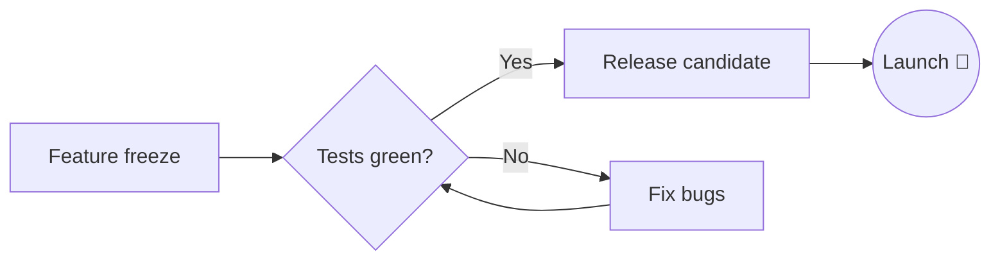

# 🚀 Aurora — Launch Plan

Everything for the **v1.0 release** in one place. Edit on the left,
read on the right — *the preview follows as you type*.

> [!TIP]
> Drag the divider anywhere. Near the middle it **snaps back to 50/50**.

## ✅ Checklist

- [x] Freeze features and update the changelog
- [x] Run the full test suite on Windows 10 and 11
- [ ] Record the demo video
- [ ] Publish the release notes :tada:

## 📊 Status

| Area          | Owner  | Progress | ETA        |
|---------------|:------:|---------:|------------|
| Editor core   | Maya   |     100% | done       |
| Preview       | Leo    |      90% | Friday     |
| Translations  | Ana    |      75% | next week  |

> [!WARNING]
> The beta build expires on **31 October** — remind testers to update.

## 💻 Code

```python
def release(version: str, channels: list[str]) -> None:
    """Ship a build to every channel."""
    for channel in channels:
        upload(version, channel)
        notify(f"Aurora {version} is live on {channel} 🎉")
```

## 🧮 Capacity

Average load per server is $\bar{x} = \frac{1}{n}\sum_{i=1}^{n} x_i$, and we keep

$$
\text{headroom} = 1 - \frac{\text{peak}}{\text{capacity}} \geq 0.25
$$

## 🔀 Release flow



## 📝 Notes

Questions go to the team channel[^1]. Keyboard shortcut for the preview:
<kbd>Ctrl</kbd>+<kbd>Alt</kbd>+<kbd>M</kbd>.

[^1]: Or ping the release captain directly.
